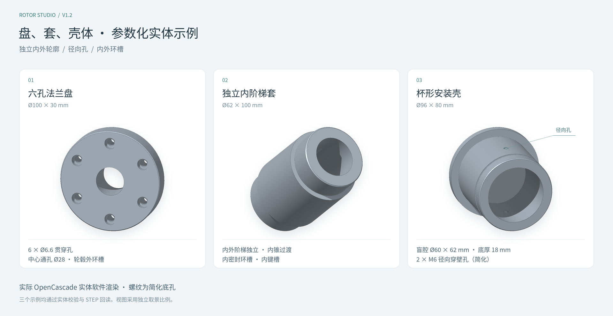

# Rotor Studio v1.2 · 回转体参数化建模工具

使用 **JavaScript、Three.js、Node.js 与 OpenCascade WebAssembly** 开发的回转体零件建模工具。支持轴、盘、套筒与回转壳体，通过独立内外轮廓、齿轮、孔和槽构造连续实体；提供二维 / 三维尺寸直接输入、参数工程保存以及 STEP、STL、GLB、OBJ 导出。

建模计算在浏览器的 Web Worker 中完成。Node.js 负责本地文件服务及开发构建，不需要另行部署几何计算服务器。



上图由三个示例的实际 OpenCascade 实体网格进行软件渲染，采用独立取景比例；杯壳的 M6 孔显示简化底孔。它是示例实体图，不代表浏览器 GPU 画面的验收结果。示例工程与 STEP 文件见下文“新增模板与交付示例”。

## 快速启动

### 使用交付压缩包

压缩包已包含 `dist/` 与几何内核 WASM，**不需要先运行 `npm install`**。

1. 安装 Node.js。项目要求 **20.19 或以上**，建议使用 **22.12 以上的 22.x 或 24.x**。
2. 将压缩包完整解压到一个目录。
3. Windows 双击 `start-local.cmd`；macOS / Linux 在该目录执行 `sh start-local.sh`。
4. 保持启动窗口打开，在 Chrome 或 Edge 中访问 **http://127.0.0.1:4173**。

也可以在项目目录直接执行：

```bash
node server.mjs
```

按 `Ctrl+C` 停止服务。不要直接双击 `dist/index.html`；浏览器需要通过 HTTP 加载模块、Web Worker 和 WASM 文件。

本地服务默认只监听 `127.0.0.1`。可以通过 `PORT` 修改端口，通过 `HOST` 修改监听地址；例如端口被占用时：

```powershell
# Windows PowerShell
$env:PORT = "4174"
node server.mjs
```

```bash
# macOS / Linux
PORT=4174 node server.mjs
```

随后访问 `http://127.0.0.1:4174`。交付包中的页面、依赖与 WASM 均由本地提供，正常启动和建模不依赖外部 CDN。

### 三维显示要求

交互式三维视图需要浏览器启用 WebGL。建议使用开启硬件加速的 Chrome 或 Edge；若浏览器显示“当前浏览器未启用 WebGL”，可在浏览器设置中打开硬件加速并重新启动浏览器。

无法建立 WebGL 上下文时，工具仍允许参数编辑、二维轮廓与孔位查看、JSON 保存、CSV 孔表以及 STEP / STL 导出，并禁用三维视角按钮和 GLB / OBJ 导出。详细验证范围见后文“自动检查与验证范围”。

## 已实现的功能

| 需求 | 当前实现 |
| --- | --- |
| 自定义阶梯数量和位置 | 1～24 段；支持新增、复制、删除、上移、下移、编辑轴向起点；可拖动轮廓图分界线调整位置 |
| 调整阶梯尺寸 | 独立设置长度、圆柱直径、圆锥两端直径及左右端部 45° 倒角；支持点击三维尺寸标注和底部轮廓数字直接输入 |
| 所有设计尺寸可调 | 外阶梯、内阶梯、齿轮、键槽、孔与环槽的独立尺寸均有参数；受几何关系约束的派生尺寸自动联动 |
| 将部分圆柱段改为齿形 | 任意阶梯可切换为直齿轮；支持模数、齿数、压力角、齿宽、相位、齿顶高系数、齿根高系数与齿厚减薄量 |
| 添加键槽 | 支持双圆头、双方头、左圆右方、左方右圆及圆盘刀半圆键槽；可调位置、宽度、深度、角度，平键槽设置总长，半圆键槽设置圆盘刀直径 |
| 设置端面孔 | 左右端面中心孔、偏心孔、等分圆周孔阵列；支持盲孔、通孔及平底沉孔 |
| 盘、套、壳体的独立内腔 | 内圆柱 / 内圆锥阶梯独立于外轮廓分段；支持左右入口、入口偏移、盲腔、贯穿腔及适用情况下的壁厚 / 底厚驱动 |
| 通用孔与简化螺纹 | 端面孔、圆柱面径向孔及阵列；分别选择指定深度、穿透当前壁、贯穿全部；保存螺纹规格、旋向、公差带记录、起牙偏移与有效牙深 |
| 内外槽特征 | 外环槽、内环槽与矩形端内键槽，均参与真实实体切除 |
| 导出三维模型与孔表 | STEP 实体、二进制 STL、GLB、OBJ；JSON 保存参数工程，CSV 保存逐孔位置和螺纹语义 |

附带撤销/重做、浏览器自动保存、可调侧栏宽度、显示精度切换、材料质量估算、尺寸标注、显示剖切、自动旋转和标准视角。

## 第一次建模

1. **从示例开始。** 默认打开“阶梯齿轮轴”。示例菜单保留五级阶梯轴、法兰连接轴、空心套筒，新增六孔法兰盘、独立内阶梯套和杯形安装壳。
2. **编辑阶梯。** 在“外形”页选择某段，输入长度和直径；也可以点击三维视图中的尺寸标注，或底部轮廓上的尺寸数字，在尺寸输入框中直接修改。三维视图与底部轮廓均可选择阶梯。
3. **调整轴向位置。** 编辑当前段起点会联动前一段长度，并移动当前及后续阶梯；拖动轮廓图分界线则同时调整相邻两段长度，保留总长。
4. **添加齿形。** 将该段类型改为“直齿轮”，输入模数、齿数和压力角。该段长度即齿宽。节圆直径 `d = 模数 × 齿数`，齿顶与齿根直径按系数联动。
5. **添加内腔、键槽和孔。** 原有键槽与端面孔在对应页编辑；“特征”页用于独立内阶梯、通用孔、环槽和内键槽。先建立内腔，再建立引用它的内槽或穿壁孔。平键槽可分别选择左右端的圆头或方头；半圆键槽以圆盘刀直径与深度确定槽长。几何校验会指出越界尺寸、孔阵列重叠和引用失效等问题。
6. **等待“实体已就绪”。** 然后使用“导出模型”导出文件。使用“保存工程”下载参数 JSON；有简化螺纹时，同时导出“孔位与螺纹参数表”CSV，以保留模型文件未表达的设计语义。

界面会将合法工程参数自动保存到当前浏览器。不同浏览器、不同访问地址的自动保存相互独立；需要移动工程或备份时请下载 JSON。切换示例和恢复默认工程后，可以通过撤销返回。

### 新增模板与交付示例

| 模板 | 参数与用途 | 可直接打开的工程 | CAD 实体 |
| --- | --- | --- | --- |
| 六孔法兰盘 | 最大外径100 mm、总长30 mm；Ø28中心通孔、六个Ø6.6贯穿孔、沉孔与轮毂环槽 | [flange-disk.rotor.json](examples/v1.2/flange-disk.rotor.json) | [flange-disk.step](examples/v1.2/flange-disk.step) |
| 独立内阶梯套 | 最大外径62 mm、总长100 mm；三段外形与四段内轮廓错位，含内锥过渡、内环槽和内键槽 | [independent-sleeve.rotor.json](examples/v1.2/independent-sleeve.rotor.json) | [independent-sleeve.step](examples/v1.2/independent-sleeve.step) |
| 杯形安装壳 | 最大外径96 mm、总长80 mm；Ø60×62 mm盲腔、18 mm底厚、两个M6简化径向穿壁孔与外环槽 | [cup-housing.rotor.json](examples/v1.2/cup-housing.rotor.json) | [cup-housing.step](examples/v1.2/cup-housing.step) |

示例的几何统计与 STEP 回读数据保存在 [examples/v1.2/validation-summary.json](examples/v1.2/validation-summary.json)。原来的 [默认齿轮轴工程](examples/rotor-default.rotor.json)、[STEP](examples/rotor-default.step) 和 [STL](examples/rotor-default.stl) 仍保留。

### 直接输入尺寸

单击可编辑的三维尺寸标注、底部轮廓数字或选中特征下方的尺寸条，使用同一个输入框修改数值。长度按 mm、角度按 °、孔数量按整数显示；按 Enter 或点击“应用”提交，按 Esc 或取消关闭。合法修改参与撤销/重做；非法修改显示原因并保留原工程。

| 点击的尺寸 | 提交后的参数变化 |
| --- | --- |
| 某段长度 / 齿宽 | 修改该段长度，后续阶梯随之移动 |
| 圆柱直径 | 仅修改当前圆柱的直径 |
| 圆锥左端 / 右端直径 | 仅修改选中的一端，另一端保持原值 |
| 齿顶直径 | 逆算模数，保持齿数、齿宽、压力角与齿顶/齿根高系数 |
| 轴向起点 | 调整前一段长度，移动当前及后续段；第一段 `X=0` 固定 |
| 零件总长 | 仅调整末段长度，前面的阶梯保持原值 |
| 内阶梯长度 / 内径 / 内锥两端直径 | 只修改对应内轮廓参数；外轮廓保持原值，后续内阶梯沿入口方向联动 |
| 内腔入口偏移 | 移动内腔入口；偏移范围保留材料，贯穿末内段长度随之派生 |
| 适用内圆柱的壁厚 | 保持外径，通过最小可用外半径逆算该内段直径 |
| 单盲腔对侧底厚 | 保持外形与前面内阶梯，只改变最后内阶梯长度 |
| 通用孔、环槽、内键槽尺寸 | 修改所选孔径、位置、角度、深度、槽宽等参数；数量必须为整数 |
| 有效牙深 / 起牙偏移 | 修改螺纹语义并检查连续材料，不改变简化底孔直径或钻深 |

尺寸修改不会按比例缩放键槽、孔或倒角；发生键槽越界、孔穿出轴身、倒角重叠等情况时，会拒绝该修改。输入框接受如 `40`、`40.125`、`.5` 的数值，不接受单位文字、千分位或科学计数法文本。输入值不会额外取整或截成两位小数。

贯穿内腔的最后一段长度、贯穿孔深度与穿壁孔的“目标内腔壁厚”是只读派生量，不能独立编辑。底部可以切换轴向剖面和端面孔位参数示意；其中的孔线、槽投影和螺纹双圆符号用于定位，实际布尔切除结果应结合实体与显示剖切查看。

## 盘、套与回转壳体的建模规则

### 独立内外轮廓与有序特征

外轮廓仍由连续回转阶梯组成。内腔使用自己的圆柱 / 圆锥阶梯数组，数量与分界位置不必和外阶梯一致。盲腔设置各段长度；贯穿内腔的最后一段使用剩余总长，原来的末段长度作为切换模式的草稿保留。

“特征”列表按顺序执行。穿壁孔、内环槽和内键槽必须引用列表中位于其前方且已启用的内腔；调整顺序、停用或删除宿主时，需一并处理这些依赖。原有轴、齿轮、倒角、外键槽与旧端面孔继续采用原生成路径，在此基础上执行新特征。

内径、外径和壁厚满足关联关系，不能同时作为三个互相独立的驱动量。壁厚输入保持外径并修改内径；跨多个外圆柱阶梯时取所在区间的最小可用外半径。多内腔可能相通，因此多个内腔同时启用时不提供单腔底厚驱动。

### 通用孔的三种终止方式

| 终止方式 | 可用位置 | 行为 |
| --- | --- | --- |
| 指定深度 / 盲孔 | 端面、径向 | 从入口沿孔轴钻至指定深度，形成平底孔 |
| 穿透当前壁 | 径向 | 引用一个上游圆柱内腔，完整打通近侧壁并保留背壁 |
| 贯穿全部 | 端面、径向 | 端面孔沿 X 穿至另一端；径向孔穿过宿主直径，在套筒或壳体上会同时打通近壁与背壁 |

径向孔当前仅支持外圆柱宿主。整个孔、沉孔及启用螺纹的包络须落在同一个外圆柱非倒角区间；穿当前壁还要求完整孔截面落在所引用的同一个内圆柱段内。端面孔以分布圆直径确定偏心位置；径向阵列共享轴向位置，绕轴等分角度。

“目标内腔壁厚”是外圆与所选内腔的半径差。其他内腔、环槽、键槽或孔可能使实际局部壁厚更小，该标注不等于复杂相交实体的全局最薄壁厚。

### 简化螺纹、环槽与内键槽

螺纹孔采用**真实底孔实体 + 螺纹语义参数**：可记录公称直径、螺距、旋向、公差带、起牙偏移与有效牙深；提供 M3～M12 常用粗牙切削攻丝底孔建议。实际螺旋牙形尚未生成，公差带记录不代表已实现几何公差或完成制造校核。

钻孔深度与有效牙深分别控制。有效牙段需避开曲面入口的不完整材料和沉孔，并位于连续材料内；不能跨过空腔把背壁合并计入牙长。校验还会检查后续去料是否破坏已有螺纹。与孔或键槽的碰撞使用保守包络，边界设计可能被保守拒绝，此时可调整位置、缩短牙深或取消该螺纹语义。

外环槽向内减小外圆半径，内环槽向外增大内孔半径；两者均限圆柱宿主。内键槽为矩形端平底槽，从内圆面向外切除，可调轴向位置、长度、宽度、深度与角度。内槽的位置始终从对应内阶梯的全局 X 左边界量起，不因内腔采用右端入口而反向。

## 坐标、位置与尺寸规则

- **X 为轴向**：最左端面为 `X=0`，向右为正方向。
- **Y 向上，Z 向前**：周向角度从 `+Y` 的 `0°` 开始，绕 `+X` 按右手规则增加；`90°` 指向 `+Z`。
- 界面的长度、直径、深度、模数和倒角均以 **mm** 表示，角度以 **°** 表示。
- 相邻阶梯连续连接；后段起点由前面各段长度累计得到，不创建悬空轴段。
- 键槽位置相对于所属阶梯的左边界。平键槽总长包含所选的圆头端；半圆键槽位置指有效槽口的左端，槽长由圆盘刀直径和深度联动计算。
- 端面孔沿 X 轴钻入；径向孔朝轴心方向钻入。深度均从入口沿钻轴量取，贯穿范围由终止方式决定。
- 材料用于估算质量，不改变几何。预设钢、铝合金、钛合金密度为演示取值。

圆锥倒角、键槽深度基准、孔穿过多个阶梯时的检查规则等详见 [建模说明](docs/建模说明.md)。

### 键槽类型

双圆头、双方头、左圆右方和左方右圆均为平底键槽，其中“左 / 右”按 X 轴从小到大定义。双圆头槽要求总长不小于槽宽；单圆头槽要求总长不小于槽宽的一半。

半圆键槽使用圆盘刀实体切除，轴向剖面为圆弧底。它只允许放在圆柱段，设置圆盘刀直径 `D`、槽深 `h` 与槽宽后，轴向中心截面的有效槽长为 `L = 2√(h(D−h))`。槽深必须小于圆盘刀半径及轴身允许半径。平键槽的长度值作为草稿保留，切回平键槽时继续使用；它不控制半圆键槽的实体长度。

原有 `round` / `square` 工程保持兼容。v1.2 界面打开或恢复合法的 `schemaVersion: 1` 工程时，会自动升级为 v2，保留旧 ID、数值和几何行为，再增加零件类别与新特征容器。旧文件没有圆盘刀直径时，打开工程会补充 `24 mm` 默认值，已有的显式刀径不被替换。槽型名称用于描述几何，不代表已按某一 A / B / C 型标准完成配合与公差校核。

## 导出格式与单位

| 格式 | 文件内容 | 单位与使用方式 |
| --- | --- | --- |
| STEP | 封闭 B-Rep 实体；键槽和孔参与实际布尔切除 | mm；适合继续进入 CAD / CAM 处理 |
| STL | 二进制三角网格 | 数值按 mm 写出；STL 本身没有通用单位字段，导入时请选择 mm |
| GLB | 单一零件网格与显示材质 | 按 glTF 约定将 mm 转成 m；180 mm 对应 0.18 m |
| OBJ | 零件三角网格 | 数值按 mm 写出；没有尺寸线、网格地面或其他辅助物 |
| JSON | 完整参数工程，界面保存版本为 `schemaVersion: 2` | 保留外形、独立内腔、有序特征、孔与螺纹语义及全部可编辑草稿；兼容打开 v1 |
| CSV | 孔位与螺纹参数表，每个孔实例一行 | 记录入口坐标、钻轴方向、终止方式、底孔 / 沉孔尺寸、螺纹规格、旋向、公差带、起牙偏移与有效牙深；长度为 mm |

STEP 的圆柱、圆锥、圆孔与圆弧槽端使用内核几何；齿轮齿侧为渐开线采样后构成的近似边界。STEP 导出不等于所有齿面均为解析渐开线曲面。

**简化螺纹在 STEP / STL / GLB / OBJ 中均表现为底孔，不包含实体牙形；STEP 也没有标准螺纹 PMI。** JSON 保存完整编辑语义，CSV 供随模型交换孔位和螺纹参数。CSV 是设计参数表，不是标准工程图、数控程序或公差检验报告；贯穿模式的“指定钻深”留空，避免把内部刀具行程误当作用户设置的孔深。

显示剖切、线框和尺寸标注都不会改变模型文件。改变网格显示精度会改变 STL / GLB / OBJ 的三角化细密程度，不改变 STEP 所用实体。

**请同时保存 JSON 与需要交换的模型格式。** 本工具通过 JSON 恢复参数工程，不从 STEP、STL、GLB 或 OBJ 反向恢复阶梯历史；当前导入入口仅接受参数 JSON。

## 当前建模边界

- 齿轮支持**无变位外直齿的渐开线采样几何**，不包含斜齿、变位齿轮、滚刀包络齿根、根切生成、修缘与齿面修形。
- 模数、齿数与节圆直径存在约束关系；它们不能同时作为互相独立的尺寸。
- 圆柱和圆锥支持相对轴线 45° 的直倒角，暂未提供圆角。齿轮段不支持非零端部倒角。
- 孔为平底圆孔，沉孔为平底圆柱沉孔；暂未包含钻尖、锥形沉头与真实螺纹牙形。螺纹标记是界面与孔表中的语义说明。
- 壳体范围为具有回转基体的杯壳、套壳等；当前不支持箱体、任意二维草图、自由曲面壳体或任意方向孔。
- 暂未支持“到任意指定面”的终止模式；穿当前壁需要明确的上游圆柱内腔目标。
- 暂未包含标准 PMI、尺寸 / 形位公差的几何实施、标准键配合或齿轮啮合与强度校核。
- 剖切仅裁剪显示，不生成真实截面封盖，也不改变实体。

工具会检查基本几何有效性和相交情况；用于实际制造的齿轮、键槽配合与孔位，还需要在 CAD / CAM 流程中核验尺寸、壁厚、工艺和精度要求。

校验中的 **0.05 mm** 是避免几何退化和切穿的内部阈值，不能作为建议制造壁厚、承载能力或材料安全余量。通过几何校验也不等于已进行强度、疲劳、密封或加工可达性分析。

## 鼠标操作与快捷键

| 操作 | 功能 |
| --- | --- |
| 三维视图左键拖动 / 单指拖动 | 旋转视角 |
| 右键拖动 / 双指移动 | 平移视角 |
| 滚轮 / 双指缩放 | 缩放 |
| 单击实体或底部轮廓段 | 选择对应阶梯 |
| 单击三维尺寸标注或底部轮廓数字 | 打开对应尺寸的直接输入框 |
| 单击内腔轮廓、孔位示意或特征列表 | 选择对应特征，显示其参数与共享尺寸条 |
| 双击三维视图，或 `F` | 适应窗口 |
| `Ctrl+S` / `⌘S` | 下载参数工程 JSON |
| `Ctrl+Z` / `⌘Z` | 撤销工程修改 |
| `Ctrl+Shift+Z` / `⌘Shift+Z` | 重做 |
| 输入框中 Enter | 提交当前输入 |
| Esc | 关闭弹出菜单或取消尺寸编辑 |
| 轮廓分界线获得焦点后按 ← / → | 每次移动边界 1 mm，同时保持总长 |
| 侧栏分隔条获得焦点后按 ← / → | 调整侧栏宽度 |

输入框正在编辑时，系统保留文本编辑的撤销行为；离开输入框后，撤销作用于工程。

## 开发与构建

开发源代码需要安装依赖：

```bash
npm install
npm run dev
```

开发服务器地址以终端实际输出为准。构建和启动本地产物：

```bash
npm run build
npm start
```

也可使用项目记录的 pnpm 版本及 `pnpm-lock.yaml`：

```bash
pnpm install --frozen-lockfile
pnpm run dev
```

请选用一种包管理器完成同一次开发。交付目录中的 `dist/` 为静态构建产物；修改源代码后应重新构建，`node server.mjs` 才会提供更新后的页面。

### 复现三模板实体与示例图

先安装项目的 Node.js 依赖；渲染示例图另外需要 Python、NumPy、Pillow，以及支持中文的字体。以下命令在项目根目录执行，将 `--font` 后的路径替换为本机中文字体文件：

```bash
node scripts/export-rotational-examples.mjs /tmp/rotor-studio-v1.2-mesh
python scripts/render-rotational-preview.py --mesh-dir /tmp/rotor-studio-v1.2-mesh --font /path/to/NotoSansCJK-Regular.ttc
```

第一步根据当前模板重建 `examples/v1.2/` 中的 JSON、STEP、统计与回读数据，并生成临时实体网格；第二步读取这些网格，输出 `docs/screenshots/rotational-parts-v1.2.png`。顺序不能颠倒。正常使用建模页面无需安装 Python 或图像渲染依赖。

### 代码结构

| 文件 | 职责 |
| --- | --- |
| `src/main.js` | 界面、输入提交、阶梯轮廓、工程历史、自动保存、导入导出与构建状态 |
| `src/schema.js` | 参数模型、派生尺寸、案例、输入校验及几何限制 |
| `src/features.js` | v2 特征构造、内腔 / 孔定位、尺寸规格、引用与几何校验、新模板 |
| `src/dimensions.js` | 三维与轮廓尺寸的统一编辑规格、受约束联动与不可变提交 |
| `src/cad.js` | OpenCascade 实体构造、渐开线采样、布尔运算、网格化、物性与 STEP / STL 导出 |
| `src/cad-features.js` | 独立内腔、通用孔、内外环槽与矩形内键槽的有序实体切除 |
| `src/cad.worker.js` | WASM 初始化、几何任务串行执行、最近一次成功实体缓存 |
| `src/viewport.js` | 单一 Three.js Scene / Canvas、灯光材质、拾取、尺寸、显示剖切、GLB / OBJ 导出 |
| `src/feature-view.js` | 新特征的三维尺寸锚点、辅助轮廓与简化螺纹语义标记 |
| `src/feature-panel.js` / `src/feature-ui-model.js` | 特征面板、合法初值与依赖处理 |
| `src/feature-profile.js` / `src/feature-report.js` | 二维内轮廓 / 孔位示意、尺寸目标映射与 CSV 孔表 |
| `src/style.css` | 界面布局与主题样式 |
| `server.mjs` | 不依赖第三方包的 Node.js 静态文件服务器 |
| `tests/` | 几何、输入校验和导出文件测试 |
| `docs/建模说明.md` | 参数定义、公式、边界说明及技术资料 |

几何 Worker 以完整参数的序列化结果作为缓存键。新实体构造成功后才替换旧缓存并释放旧实体；失败会保留上次成功的实体用于界面参考。界面通过参数版本阻止把旧实体当作当前未成功的参数导出。

锁定的主要依赖：Three.js `0.180.0`、Replicad `0.19.1`、replicad-opencascadejs `0.19.0`、Vite `7.1.7`、Lucide `0.468.0`。

## 自动检查与验证范围

自动化检查入口：

```bash
npm test
```

需要分别查看每项测试名称时，可以运行：

```bash
node tests/schema.test.mjs
node tests/cad.test.mjs
node tests/dimensions.test.mjs
node tests/viewport-dimensions.test.mjs
node tests/viewport-export.test.mjs
node tests/features.test.mjs
node tests/rotational-cad.test.mjs
node tests/viewport-features.test.mjs
node tests/feature-ui.test.mjs
```

v1.2 当前自动检查分组如下。最终测试项目数、运行结果、构建状态与交互验收范围以 [验证记录](docs/验证记录.md) 为准。

| 分组 | 文件 |
| --- | --- |
| 原参数结构与几何约束 | `schema.test.mjs` |
| 原轴 / 齿轮 / 槽 / 孔实体 | `cad.test.mjs` |
| 统一尺寸输入与联动 | `dimensions.test.mjs` |
| 三维尺寸按钮、焦点与选择 | `viewport-dimensions.test.mjs` |
| OBJ / GLB 导出 | `viewport-export.test.mjs` |
| v2 特征约束与旧工程迁移 | `features.test.mjs` |
| 盘 / 套 / 壳实体与 STEP 回读 | `rotational-cad.test.mjs` |
| 新特征尺寸坐标与显示语义 | `viewport-features.test.mjs` |
| 特征初值、依赖、二维目标与孔表 | `feature-ui.test.mjs` |

覆盖内容包括：

- 圆柱、圆锥与倒角的体积/表面积和解析结果一致，轴向范围正确。
- 阶梯融合为单一连续实体；五种键槽、左右盲孔、通孔、沉孔与孔阵列实际去料。
- 直接尺寸输入的联动、越界保护、撤销重做、原生按钮点击/Enter/Space，以及重建后的输入焦点保持。
- 左右单圆头槽方向、半圆键槽的圆弧槽底、独立积分体积、周向旋转及新增槽型STEP往返。
- 内置案例与多齿轮阶梯可以构建，导出 STEP 后重新导入的体积保持一致。
- STL 为可解析的二进制网格；OBJ 保持毫米原点和尺寸；GLB 只包含一个零件并正确转换为米。
- 无效数字、错误工程结构、非法尺寸、孔阵列越界/重叠、键槽越界及不支持的齿轮倒角能够给出诊断。
- GLB / OBJ 导出不会带入辅助线、显示变换、线框或剖切状态，也不会修改源显示网格。
- 内外阶梯错位与左右入口内锥的体积、盲底和定位；穿当前壁保留背壁，贯穿全部切除两侧壁。
- 内外环槽、内键槽、三个新模板与 v1 齿轮工程升级后的实体行为；简化螺纹开关不改变底孔实体。
- 有效牙深与钻深分开、后续去料破坏螺纹的诊断、非法输入不污染工程，以及 JSON / CSV 中的设计语义。

实体数值测试、软件渲染示例图与浏览器 GPU 视觉验收分别说明不同层面的行为。浏览器实测范围及限制记录在 [验证记录](docs/验证记录.md)；在启用 WebGL 的桌面浏览器中还应检查金属材质、阴影、拾取、尺寸标注和视角交互。

## 技术资料

- [Replicad：作为建模库使用，包含 Web Worker、Three.js 与 STEP / STL 集成](https://replicad.xyz/docs/use-as-a-library/)
- [Three.js：GLTFExporter](https://threejs.org/docs/pages/GLTFExporter.html)
- [Khronos：glTF 坐标系与单位](https://registry.khronos.org/glTF/specs/2.0/glTF-2.0.html#coordinate-system-and-units)
- [KHK：齿轮尺寸计算](https://khkgears.net/new/gear_knowledge/gear_technical_reference/calculation_gear_dimensions.html)
- [OSG：螺纹尺寸与螺距资料](https://osgtool.com/800274ca-v3/)
- [Guhring：切削丝锥与底孔范围资料](https://guhring.com/ProductsServices/SizeDetails?EDP=9029200030000)

更完整的参数约束、工作规模与齿形说明见 [建模说明](docs/建模说明.md)。
