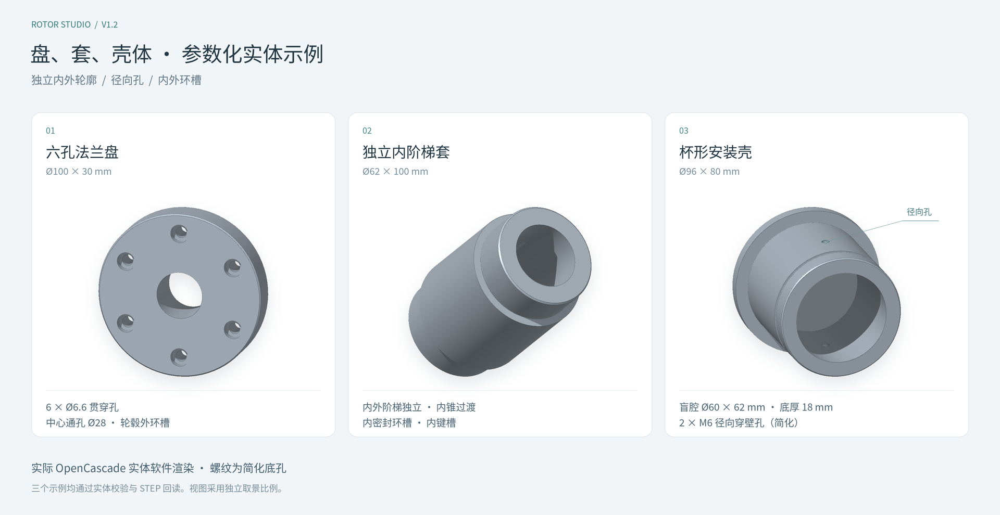

# 回转体参数化建模说明 · v1.2

本工具使用 JavaScript、Three.js 与 OpenCascade WebAssembly 建立和显示参数化回转体。轴、盘、套与回转壳体共用连续外轮廓，可增加独立阶梯内腔、端面 / 径向孔、内外环槽和键槽。实际去料参与实体运算，模型可导出为 STEP、STL、GLB 和 OBJ；参数 JSON 保存设计历史与螺纹语义，CSV 保存逐孔参数。

本文说明当前参数的几何含义与约束。软件支持回转基体及所列局部特征，尚未提供箱体、任意二维草图、自由曲面壳体、真实螺旋牙形或标准 PMI。已有轴、直齿轮、倒角与五种外键槽的规则继续保留。

## 1. 坐标与单位

- 零件的回转轴为 **X 轴**，最左端面为 `X = 0`，向右为正向。
- **Y 轴向上，Z 轴向前**。所有长度、直径、模数、倒角与深度的界面单位均为 **mm**。
- 周向角度以 `+Y` 方向为 `0°`，按绕 `+X` 轴的右手规则增加，`90°` 指向 `+Z`。
- 阶梯连续相接。第一个阶梯从 `0` 开始，第 `i` 段起点等于其之前所有段的长度之和。总长是各段长度之和。

例如默认工程中，五段区间依次为 `0–28`、`28–60`、`60–94`、`94–146` 和 `146–180 mm`。修改第二段长度为 `40 mm` 后，第三段开始于 `68 mm`，后续段随之向右移动 `8 mm`。

编辑某段的轴向起点时，界面通过调整它前一段的长度保持相邻连接。不会建立悬空轴段。删除或重新排序阶梯时，应检查附属于该阶梯的键槽及全轴端孔关系。

## 2. 回转阶梯

每一段都可单独设置名称、长度和类型。

| 类型 | 独立参数 | 派生尺寸 |
| --- | --- | --- |
| 圆柱 | 长度、直径、左右倒角 | 起点、终点 |
| 圆锥 | 长度、左端直径、右端直径、左右倒角 | 起点、终点、锥度 |
| 直齿轮 | 齿宽、模数、齿数、压力角、相位、齿顶高系数、齿根高系数、齿厚减薄量 | 节圆、基圆、齿顶圆、齿根圆直径 |

“所有尺寸可调”表示全部设计参数都在参数工程中明确表达。受几何关系约束的尺寸采用联动计算，例如直齿轮的模数、齿数与节圆直径不能同时作为彼此独立的自由量。

### 2.1 端部倒角

圆柱两端的倒角值 `C` 为 `C × 45°`，其径向退让和轴向占用均为 `C`。圆锥段仍使用相对轴线 `45°` 的倒角线，输入 `C` 表示端面半径减小量。

对于长度为 `L`、左右半径为 `r₀`、`r₁` 的圆锥，定义径向斜率 `k = (r₁ − r₀) / L`。左倒角占用轴向距离 `C左 / (1 − k)`，右倒角占用 `C右 / (1 + k)`。因此，圆锥的端面退让值与轴向占用通常不相等。

两端倒角不得相交、不得越过轴心。存在倒角时要求 `|k| < 1`。当前直齿轮段两端倒角必须为 `0`，工具会明确拒绝非零值。

### 2.2 点击尺寸直接修改

三维视图中的可编辑尺寸标注、底部轴向轮廓上的尺寸数字和当前特征的尺寸条共用同一个输入框。长度按 mm、角度按 °、孔数量按整数显示；按 Enter 或点击“应用”提交，按 Esc 或取消放弃本次输入。底部二维入口在无法启用 WebGL 的浏览器中仍可编辑参数。

| 尺寸 | 编辑语义 |
| --- | --- |
| 段长、齿宽 | 修改本段长度；后续段沿 X 轴平移 |
| 圆柱直径 | 仅修改本段外径 |
| 圆锥左 / 右端直径 | 仅修改所选端面直径，另一端直径不变 |
| 齿轮齿顶直径 | 由 `m = dₐ / (z + 2hₐ*)` 逆算模数，齿数、齿宽、压力角与其他齿形参数不变 |
| 轴向起点 | 以前一段起点为基准重新计算前段长度；当前及后续段随之平移，当前段长度不变 |
| 零件总长 | 保持前面所有阶梯不变，仅重新计算末段长度 |
| 内阶梯长度 | 保持外轮廓，修改本内段并沿入口方向移动后续内段；贯穿末段为只读派生长度 |
| 内径 / 内锥入口径 / 末端径 | 修改从入口向内定义的对应直径，外形与另一端参数保持原值 |
| 内腔入口偏移 | 只移动内腔入口；偏移区域保留材料，贯穿末段长度由剩余总长重算 |
| 可用的壁厚驱动 | 保持外径，逆算所选内圆柱直径；只对内外均可明确解释为圆柱的组合开放 |
| 单盲腔对侧底厚 | 保持外形与前面内阶梯，只改变最后内段长度 |
| 通用孔的位置 / 孔径 / 角度 / 阵列数量 | 修改唯一对应参数；非盲孔不提供独立孔深驱动 |
| 环槽、内键槽尺寸 | 修改对应位置、宽度、长度、径向深度或角度，宿主尺寸不随之缩放 |
| 有效牙深 / 起牙偏移 | 只改螺纹语义参数，底孔实体尺寸保持原值并重新检查材料范围 |

第一段起点固定在 `X=0`，不能直接编辑。直接输入起点与拖动阶梯分界线具有不同的联动规则：直接输入起点只改变前段长度，拖动分界线同时改变相邻两段长度并保留总长。

例如，默认模型总长为 `180 mm`，前四段长度合计为 `146 mm`。直接把总长改为 `196 mm` 后，末段从 `34 mm` 变为 `50 mm`，前四段、键槽与孔的参数全部保持原值。中央齿轮 `z=24`、`hₐ*=1` 时，将齿顶直径从 `52 mm` 改为 `65 mm`，模数由 `2` 联动为 `2.5`。

尺寸输入不自动缩放键槽、孔或倒角。新尺寸必须通过完整参数校验；若缩短阶梯使键槽越界、缩小直径使孔穿出侧壁、缩短总长使盲孔贯穿，或使倒角互相重叠，工具会显示原因并保留原工程。成功的修改作为一次工程编辑，可撤销或重做。

允许十进制数字和小数，包括 `40`、`40.125`、`.5`。空值、非有限值、单位文字、千分位及科学计数法文本会被拒绝。输入数值不会额外四舍五入到两位小数；轴向联动加减使用十进制系数计算，避免浮点减法把合法的 `0.1 mm` 段长误判为小于下限。

底部轴向剖面、端面孔位和三维辅助轮廓用于参数定位。二维孔线、槽投影和螺纹双圆均为示意，不能当作最终实体全部相交边界；显示剖切也不生成封盖或改变实体。选择不同内阶梯时，尺寸目标会同时记录特征 ID 与子段 ID，避免把另一内段的直径或长度写错。

## 3. 直齿轮

将某一圆柱段切换为“直齿轮”，该段整个轴向长度成为齿宽。当前为外齿、直齿、无变位的渐开线几何模型。

定义模数 `m`、齿数 `z`、压力角 `α`、齿顶高系数 `hₐ*`、齿根高系数 `h𝒇*`：

- 节圆直径：`d = m × z`。
- 基圆直径：`dᵦ = d × cos α`。
- 齿顶圆直径：`dₐ = m × (z + 2hₐ*)`。
- 齿根圆直径：`d𝒇 = m × (z − 2h𝒇*)`。
- 默认 `hₐ* = 1`、`h𝒇* = 1.25`，对应标准全齿高的常用尺寸关系。[1]

“齿厚减薄量”的单位为 mm，表示在节圆上的圆周齿厚减小量。内部字段名为 `backlash`。这一参数只改变当前零件的齿厚，不代表工具已经校核了一对齿轮的工作侧隙、中心距或啮合状态。

齿侧依据渐开线计算并采样成线段，齿顶与齿根圆弧同样采用固定采样，齿根与渐开线起点之间使用径向过渡。**STEP 保留真实封闭 B-Rep 实体，但采样齿廓仍是近似齿形。** 工具不模拟滚刀展成的齿根包络、修缘、根切、齿面修形或热处理变形，也不对齿轮强度、精度等级和配对啮合进行认证。

小齿数可能产生标准齿条展成时的根切风险。工具会给出提示；已出现尖齿或负齿厚的参数会阻止建模。建议将当前齿轮用于结构设计、布局、可视化和几何验证。生产齿轮应另行完成齿形、配对和制造工艺校核。

## 4. 键槽

键槽附属于指定阶梯，可设置局部起点、宽度、深度和周向角度。平键槽的左右端可分别选择圆头或方头；半圆键槽使用圆盘刀直径控制几何。

### 4.1 平键槽及两端形式

| 类型 | 参数值 | 轴向几何 |
| --- | --- | --- |
| 双圆头 | `round` | 左右两端均为半圆，槽底平面 |
| 双方头 | `square` | 左右两端均为直边，槽底平面 |
| 左圆右方 | `round-left` | X 较小的一端为半圆，另一端为直边 |
| 左方右圆 | `round-right` | X 较大的一端为半圆，另一端为直边 |

“左 / 右”按照轴向 X 坐标定义，与观察视角无关。以上名称描述几何形态，不声称符合某一标准中的 A / B / C 型代号。

| 参数 | 含义 |
| --- | --- |
| 局部起点 | 从所属阶梯左边界沿 X 正向测量 |
| 长度 | 槽的完整轴向长度，包含所选的圆头端 |
| 宽度 | 槽的切向宽度；圆头端半径为宽度的一半 |
| 深度 | 从下述半径基准到平底槽面的径向距离 |
| 周向角度 | `0°` 在轴顶，绕 X 轴旋转 |

圆柱键槽以外圆半径为深度基准。圆锥键槽以槽所在轴向区间的最小名义半径为基准，并保持平底，因此直径较大的一端实际切入更深。齿轮段键槽以齿根圆为深度基准，槽口会切去该方位的局部齿形。

槽必须位于所属阶梯范围内。双圆头槽总长不得小于槽宽，单圆头槽总长不得小于槽宽的一半。槽宽须小于可用直径，槽深须小于可用半径。工具还会检查浅槽是否能形成指定的完整槽宽。与倒角相交会使槽口被端面外形截断，这种情况显示提示供检查。

### 4.2 半圆键槽与圆盘刀

半圆键槽的参数值为 `woodruff`，由圆盘刀实体切除，槽底为圆柱面，在轴向中心剖面呈圆弧。当前只支持圆柱轴段。

它的主控参数为圆盘刀直径 `D`（`cutterDiameter`）、槽深 `h`（`depth`）和槽宽（圆盘刀厚度）。深度从圆柱顶部外圆向内测量。轴向中心截面的有效槽长由圆与外圆顶部切线的交点计算：

`L = 2 × √[h × (D − h)]`

例如，圆盘刀直径 `D=24 mm`、槽深 `h=3 mm` 时，有效槽长约为 `15.875 mm`。增大刀径或改变槽深后，槽长自动联动。平键槽的 `length` 值保留作为切换类型时的草稿；它不控制半圆键槽的实体长度。

`position` 仍表示有效槽口的左端，圆盘刀中心的轴向位置为 `position + L/2`。`0°` 时刀轴沿 Z，改变周向角度会将整个切除体绕 X 轴旋转。

几何约束包括：槽深大于0且小于圆盘刀半径，槽底不得穿过轴心，完整有效槽长必须位于所属阶梯范围内；同时检查槽宽处的圆柱弓高，避免所设深度不足以形成指定宽度。该几何模型不自动匹配标准半圆键尺寸系列或配合公差。

### 4.3 原有工程兼容

v1.2 界面打开、恢复或使用旧示例时，会将合法的 `schemaVersion: 1` 工程升级为 `2`。原有阶梯、齿轮、倒角、键槽与端面孔的 ID、数值和几何生成路径保持不变；新增 `partFamily` 类别与有序 `features` 数组，旧端面孔不会被悄悄转成新通用孔。

旧工程中的 `round`、`square` 保持原义。缺失的 `cutterDiameter` 补为 `24 mm`，用户已经明确设置的刀径保持原值。切换槽型时保留不参与当前几何的历史尺寸草稿，当前使用的参数仍执行完整几何约束校验。

当前不自动套用标准平键公差、键槽配合、刀具补偿或加工余量；输入的是目标槽体几何尺寸。

## 5. 原有端面孔与阵列

可以从最左或最右端面建立沿轴线方向钻入的孔，并选择盲孔或通孔。盲孔为平底圆柱孔。

- 单孔可居中，也可通过“分布圆直径 + 相位”设置偏心位置：偏心距为分布圆直径的一半。
- 多孔使用同一分布圆等角度排列，可设置数量和整体相位。
- 可增加平底圆柱沉孔。沉孔直径必须大于主孔直径，沉孔深度必须小于主孔有效深度。
- 通孔深度由零件总长决定；存储的盲孔深度参数保留，关闭通孔后继续使用。

工具沿实际孔深检查所有经过阶梯的可用半径，包含端部倒角。如果法兰上的偏置孔继续钻入较细的轴身并从侧壁穿出，会拒绝该参数。应将孔深限制在法兰实体范围内，或重新设计孔位。

同一阵列的相邻主孔、沉孔不能重叠。不同孔组相交时会提示孔腔将连通；完全重复的孔组会被拒绝。键槽与孔腔可能相通时，会显示检查提示。相交提示属于几何检查，不代替强度或最小壁厚设计。

本节的原有端面孔不包含螺纹牙形、钻尖锥底、锥形沉头、公差标记或螺纹标注。

这一节描述旧 `holes` 数组的兼容行为。v1.2 在“特征”页另提供通用孔：允许按所选终止范围进行切除，并可附加简化螺纹语义，具体见第7节。两种数据入口在工程中可以共存；升级旧工程时保留本节的原有约束，避免已有设计发生变化。

## 6. 独立内轮廓与有序特征

### 6.1 外形与内腔独立分段

外轮廓保存在 `segments`，独立内腔作为 `type: 'bore'` 特征保存在有序 `features` 数组中。每个内腔拥有自己的圆柱 / 圆锥阶梯、名称、入口方向与终止模式。内外阶梯数量可以不同，轴向分界不必重合。

例如“独立内阶梯套”的三段外轮廓分界为 `X=20、80 mm`，四段内轮廓分界为 `X=18、30、85 mm`。工具在所有内外交界与外倒角交点检查剩余壁厚，不只比较内孔两端的外径。

内段的 `diameter` 表示从所选入口进入该段时的直径，圆锥段的 `endDiameter` 表示向内走到该段末端的直径。右端入口时，这两个定义在全局 X 轴上呈反向排列；界面和尺寸编辑按入口语义对应参数，实体仍按正确的全局左右半径构造。

设总长为 `L`、入口偏移为 `o`、此前内段长度之和为 `s`、当前段有效长度为 `l`：

| 入口 | 当前内段全局 X 区间 |
| --- | --- |
| 左端 | `[o+s, o+s+l]` |
| 右端 | `[L−o−s−l, L−o−s]` |

`offset` 只把内腔入口向内移动，不会自动去除偏移区域的材料。偏移大于0时可能形成封闭入口侧材料甚至内部封闭腔体；需要端面开口时应把偏移设为0，或另外明确设计开口特征。

### 6.2 盲腔、贯穿腔与派生尺寸

盲腔使用各段设定长度，在对侧保留材料。贯穿腔的最后内段有效长度为：

`l末 = L − o − Σ前面内段长度`

原有末段 `length` 留作切回盲腔时的草稿，不控制贯穿状态的实体长度。修改外形总长、入口偏移或前面内段长度后，末段有效长度自动联动；若剩余长度不足或内腔超出实体范围，修改会被拒绝。入口偏移仍保留入口侧材料，“贯穿”在此指从设定入口到对侧端面的剩余范围。

单盲腔的对侧底厚驱动采用：

`B = L − o − Σ内段长度`

输入底厚只改变最后一段的长度，外形及前面内段不变。多个内腔可以相通：两个盲腔一旦连通，各自到对侧端面的余量不再代表实际封底。工具会提示这种情况，并在多个内腔同时启用时取消单腔底厚直接驱动。

壁厚驱动仅对内圆柱与可用外圆柱组合开放。设该内段区间的最小可用外半径为 `R最小`、内径为 `d内`，则：

`t = R最小 − d内/2`，编辑壁厚时使用 `d内 = 2 × (R最小 − t)`。

外径保持原值，不能同时把外径、内径与壁厚作为三个独立约束。跨多个外阶梯时使用最小可用外半径；复杂锥面组合请直接编辑内外轮廓直径，不提供含糊的单一壁厚驱动。这里的壁厚计算描述基体与所选内腔，任意孔、键槽、环槽相交后的全场最薄壁厚仍需进一步检查。

### 6.3 顺序、宿主与兼容性

新特征依照 `features` 列表顺序参与实体切除。穿当前壁孔、内环槽与内键槽必须引用在它们之前且处于启用状态的内腔；内槽还需引用有效内阶梯 ID。停用、删除或移动宿主到引用者之后，会使依赖失效，工具要求先处理这些引用。

原有外形、齿轮、倒角、外键槽和旧端面孔仍先按原路径构造。`partFamily` 的 `shaft / disk / sleeve / housing` 是零件类别标签，不会自动替用户修改尺寸或重新解释旧齿形。升级是扩展参数容器，旧齿轮和倒角继续复用原生成器。

## 7. 通用孔、终止范围与简化螺纹

### 7.1 端面与径向放置

通用孔为 `type: 'hole'` 特征，可选择端面或径向放置。端面孔从最左或最右端沿 X 钻入，以分布圆直径和相位决定偏心位置；多孔按同一分布圆等分。径向孔当前仅支持外圆柱宿主，其 `position` 从该外阶梯的全局左端沿 X 正向量取，`angle=0°` 位于 `+Y`，钻入方向指向轴心。

径向阵列共享轴向位置，第 `i` 个孔的角度为 `angle + i × 360° / count`。径向孔不使用 PCD 定位，切换到端面时可继续使用保留的 PCD 草稿。

深度从入口沿孔轴向内测量。径向入口基准是孔轴与名义外圆的交点，因此孔口两侧会随曲面截断；校验会拒绝深度不足以形成指定完整孔径或沉孔直径的浅孔。

### 7.2 三种终止模式

| 模式 | 端面孔 | 径向孔 |
| --- | --- | --- |
| `blind`：指定深度 / 盲孔 | 从所选全局端面量指定钻深，形成平底孔 | 从外圆入口沿径向量指定钻深，形成平底孔 |
| `through-wall`：穿透当前壁 | 不支持 | 指定上游内腔，只打通近侧壁，保留背壁 |
| `through-all`：贯穿全部 | 沿 X 穿至零件另一端 | 穿过宿主圆柱直径；空心零件的近壁与背壁均会被切穿 |

“指定深度”是刀具终止距离；若路径上已有内腔，孔可以与它连通，名称中的“盲孔”并不保证最终组合实体仍是封闭孔底。需要明确保留背壁时，使用满足条件的“穿透当前壁”。

穿当前壁必须明确引用上游已启用内腔。整个主孔、沉孔与启用螺纹的包络，应落在同一外圆柱非倒角区间和同一内圆柱段范围内；包络半径还必须小于所选内腔半径，以保证整个孔截面能够打通近侧壁。不能用这一模式指向内锥面、跨阶梯的内壁或任意选择的 CAD 面。

穿壁孔显示的“目标内腔壁厚”为外圆半径与所选内圆半径之差，是只读参考尺寸。它不等于工具在空腔中的行程，也不等于复杂相交几何的最小实际壁厚：其他内腔或槽可能已经削薄这一区域。

新通用端面孔按选择的终止范围切除实际遇到的材料，可以用于法兰上的贯穿孔，即使较细的后续轮毂没有覆盖该孔位。旧端面孔仍执行第5节的整条路径半径约束，两者不会在升级时互相转换。所有模式仍受入口边界、阵列间距、沉孔关系与最终单实体有效性约束。

沉孔为平底圆柱形，直径须大于主孔，深度须小于主孔的有效切除范围。当前没有钻尖、锥形沉头或“到任意指定面”的终止方式。

### 7.3 螺纹语义与真实底孔

启用简化螺纹后，几何仍为真实圆柱底孔，工程另外保存公称直径、螺距、旋向、公差带记录、起牙偏移和有效牙深。界面使用明确的“简化螺纹”文字或双圆符号，未构造螺旋牙面。启用螺纹不会暗中改变底孔体积；使用预设时，界面会明确填入对应的建议底孔尺寸。

常用粗牙切削攻丝预设如下。公称螺距与底孔资料参考 OSG、Guhring。[5][6] 底孔值是起始建议，不能替代针对材料、丝锥、孔深和目标公差的工艺选择，也不适用于挤压丝锥。

| 规格 | 螺距 / mm | 建议切削底孔 / mm |
| --- | ---: | ---: |
| M3 | 0.5 | 2.5 |
| M4 | 0.7 | 3.3 |
| M5 | 0.8 | 4.2 |
| M6 | 1 | 5 |
| M8 | 1.25 | 6.8 |
| M10 | 1.5 | 8.5 |
| M12 | 1.75 | 10.2 |

钻孔深度与有效牙深是两个参数。起牙偏移从孔入口沿钻轴向内量取，有效牙段必须完全位于已钻孔范围与连续材料中。沉孔范围不能计为完整有效牙段；径向曲面入口与远端出口的不完整材料区也不能计入。

以外圆半径 `R`、公称螺纹半径 `a` 的径向孔为例，入口弓高为 `s = R − √(R² − a²)`。起牙位置至少避开该弓高及沉孔深度。若该处有内圆柱半径 `r`，连续近侧材料在轴线方向最多延伸到 `R−r`；不能把内腔后的背壁合并成同一段有效牙深。内环槽等其他去料可能进一步缩短有效材料区间。

工具按最终有序特征检查螺纹语义，后添加的内腔、槽或相交孔同样可能使先前的有效牙段失效。孔与键槽的碰撞采用保守包络，可能保守拒绝部分紧邻布局；这不等于执行了完整牙形间的精确布尔检查。遇到提示时，可移动相关特征、缩短牙深或取消该螺纹语义，随后再进行实际加工设计。

公差带如 `6H` 只是参数记录，未自动赋予底孔实体公差。**STEP 不包含真实牙形或标准螺纹 PMI；应同时保存 JSON 与 CSV 孔位螺纹表。**

## 8. 环槽与矩形内键槽

### 8.1 外环槽与内环槽

环槽使用圆柱宿主，参数为轴向位置、轴向宽度和径向深度。外环槽从外圆向内切除，内环槽从所选内圆向外切除。外环槽不能跨入宿主倒角；内环槽必须引用上游内腔中的圆柱段。

位置均从宿主的全局 X 左边界量起，整个轴向槽宽须位于该圆柱段内。内腔从右端进入时，内环槽位置仍沿全局 `+X`，不会改成从右向左量取。

内槽与外槽叠加时，校验检查它们共同去料后的剩余壁厚，并同时考虑“先内槽后外槽”与“先外槽后内槽”的顺序。槽的几何名称并不代表自动匹配某个挡圈、密封圈或标准槽系列，配合尺寸需另行设计。

### 8.2 内孔键槽

内键槽为矩形端、平底的局部槽，只支持上游内腔的圆柱段，可设置位置、长度、切向宽度、径向深度和周向角度。它与第4节的五种外键槽分别保存，当前内键槽不提供圆头、半圆键或圆盘刀模式。

设内圆半径为 `r`、槽宽为 `w`、深度为 `h`，槽底在所选方位距离轴心 `r+h`，深度基准为内圆顶部。校验不仅检查槽底，还按矩形外角半径 `√((r+h)²+(w/2)²)` 检查剩余外壁。内键槽的轴向位置从对应内段的全局左端量取，整个长度不得超过该内段。

这些参数描述目标去料几何，不包含刀具补偿、拉削可达性、标准键公差或配合认证。

## 9. 导出、孔表与继续编辑

| 格式 | 内容与单位 | 建议用途 |
| --- | --- | --- |
| STEP | CAD 边界表示实体；长度使用 mm | CAD/CAM 交换、后续几何处理 |
| STL | 三角网格；坐标按 mm 写出，格式本身不储存标准单位字段 | 切片、网格检查、三维打印 |
| GLB | 三角网格与显示材质；从 mm 转换为 m | Three.js 场景、网页展示、数字样机 |
| OBJ | 单零件三角网格；坐标按 mm 写出 | 通用网格交换 |
| 参数 JSON | v2 外形、独立内腔、有序特征、原有键槽 / 孔、材料、螺纹语义与历史草稿；长度为 mm | 重新打开工程并继续参数化编辑 |
| 孔位与螺纹 CSV | 每个孔实例一行，包含入口位置、钻轴方向、终止方式、底孔 / 沉孔、螺纹规格与有效牙深；长度为 mm | 随模型交付设计语义与孔位数据 |

STEP 不包含此工具的原生参数历史树，也不包含标准 PMI、螺纹公差、尺寸公差或基准标注。STL、GLB、OBJ 同样只保存几何与相应网格信息，简化螺纹在这些格式中都是底孔。保留参数 JSON，才能继续编辑原来的阶梯、特征和语义；CSV 用于随模型传递孔位及螺纹说明，不是标准工程图、数控程序或检验报告。

CSV 将孔阵列展开为逐孔记录。位置使用全局 X / Y / Z 毫米坐标，钻轴方向为单位方向向量；只有“指定深度”模式填入指定钻深，贯穿模式按终止方式与目标内腔 ID 表达范围。有效牙深、起牙偏移与钻深分别记录，避免混淆。

JSON 不嵌入执行代码，导入同时支持 `schemaVersion: 1` 与 `2` 的严格结构、有限数及几何校验，不会把字符串数字或非法尺寸静默替换为默认值。界面加载合法 v1 后自动升级为 v2，原有参数保留。当前工程导入仅接受参数 JSON，不能从 STEP 或网格反向重建原始参数历史；界面限制 JSON 文件不超过2 MB。

GLB 使用米是为了符合 glTF 的线性单位约定。[2] 如果在其他软件中导入 STL，请显式选择 mm。Three.js 提供网格格式导出功能，而 STEP 通过实体内核导出。[3][4]

材料用于显示及估算质量。预设密度为钢 `7.85 g/cm³`、铝合金 `2.70 g/cm³`、钛合金 `4.51 g/cm³`，这些是工程演示取值，不对应某一特定牌号的材料证明。体积使用 `mm³` 时，质量估算 `kg = 体积 × 密度 / 1,000,000`。

## 10. 当前规模与检查边界

为避免浏览器因异常参数或过大工程而长时间失去响应，当前版本设置如下工作范围：

| 项目 | 范围 |
| --- | --- |
| 阶梯数量 | 1～24 段 |
| 独立设置的外段 / 内段长度 | 0.1～2000 mm；贯穿内腔末段按剩余总长派生 |
| 内腔阶梯数量 | 每个内腔1～24段，全部内腔合计不超过96段 |
| 总长度 | 不超过10000 mm |
| 圆柱/圆锥直径 | 0.5～2000 mm |
| 齿轮齿数 | 每段12～120齿，总计不超过720齿 |
| 模数 | 0.1～25 mm |
| 压力角 | 10～35° |
| 外键槽、旧孔组与新特征 | 合计不超过48个；内腔内的子段另按内阶梯限制 |
| 每孔组数量 | 1～24个 |
| 启用的孔数量 | 合计不超过96个 |

这些是本工具的执行边界，并非机械设计标准。几何内核失败时，应保留上一份成功模型并根据诊断调整参数；不能将旧模型导出并误认为它对应当前未成功的参数。

剩余壁厚中的 `0.05 mm` 是避免几何切穿、零厚面和数值退化的阈值，**不是建议制造壁厚，也不是强度或安全保证**。工具没有完成压力容器、疲劳、载荷、热变形、密封性能或加工可达性分析。对复杂特征相交，目标内腔壁厚与实际局部最薄壁可能不同，制造前仍需在 CAD / CAM 流程中复核。

当前未包含箱体、任意草图驱动、斜孔或任意方向孔、真实螺纹牙形、斜齿、圆角、标准 PMI 或公差配合自动校核。剖面与孔位示意只帮助编辑参数，不改变这一建模范围。

自动检查按原参数约束、旧实体、新特征、尺寸输入、视口目标与导出文件分类。测试入口为 `npm test`；逐组命令与检查分类见 [README](../README.md)，最终项目数、运行结果与浏览器验收边界见 [验证记录](验证记录.md)。

## 11. 内置案例与示例文件

1. **阶梯齿轮轴**：总长180 mm，五段，中央 `m2 × 24齿`、齿宽34 mm，带顶面圆头键槽及右端盲孔与沉孔。
2. **五级阶梯轴**：总长160 mm，包含圆柱阶梯、圆锥过渡与端部倒角。
3. **法兰连接轴**：总长110 mm，法兰直径88 mm，六孔阵列、沉孔和中心盲孔。
4. **空心套筒**：总长110 mm，中心通孔直径26 mm，右端沉孔直径32 mm。
5. **六孔法兰盘**：最大外径100 mm、总长30 mm；Ø28贯穿内腔，PCD 76 mm上的六个Ø6.6贯穿孔，Ø11×4 mm沉孔与轮毂外环槽。
6. **独立内阶梯套**：总长100 mm、最大外径62 mm；三段外轮廓与四段内轮廓独立，内孔含Ø32到Ø38的锥过渡、Ø34末端、内密封环槽与矩形内键槽。
7. **杯形安装壳**：总长80 mm、安装法兰外径96 mm、主体外径80 mm；右入口Ø60×62 mm盲腔，底厚18 mm；两个M6×1简化径向穿壁孔，底孔Ø5 mm、起牙偏移0.5 mm、有效牙深6 mm，另带外环槽。

图示使用示例实体网格做软件渲染，各零件分别取景；杯壳显示的是螺纹底孔，未渲染实体牙形。这张图用于说明几何案例，不能替代浏览器 WebGL 的 GPU 交互验收。

| 案例 | 参数工程 | STEP 实体 |
| --- | --- | --- |
| 六孔法兰盘 | [flange-disk.rotor.json](../examples/v1.2/flange-disk.rotor.json) | [flange-disk.step](../examples/v1.2/flange-disk.step) |
| 独立内阶梯套 | [independent-sleeve.rotor.json](../examples/v1.2/independent-sleeve.rotor.json) | [independent-sleeve.step](../examples/v1.2/independent-sleeve.step) |
| 杯形安装壳 | [cup-housing.rotor.json](../examples/v1.2/cup-housing.rotor.json) | [cup-housing.step](../examples/v1.2/cup-housing.step) |

各案例的几何统计和 STEP 回读数据见 [validation-summary.json](../examples/v1.2/validation-summary.json)。原有 [默认齿轮轴工程](../examples/rotor-default.rotor.json)、[STEP](../examples/rotor-default.step) 与 [STL](../examples/rotor-default.stl) 仍可使用。

## 技术资料

1. KHK，Calculation of Gear Dimensions，标准直齿轮的模数、齿数、基圆、齿顶圆与齿根圆关系。检索日期：2026-10-30。<https://khkgears.net/new/gear_knowledge/gear_technical_reference/calculation_gear_dimensions.html>
2. Khronos，glTF 2.0 Specification，§3.4 Coordinate System and Units，规定线性距离以米计。<https://registry.khronos.org/glTF/specs/2.0/glTF-2.0.html#coordinate-system-and-units>
3. Replicad，replicad as a library，介绍 STEP/STL 导出、Three.js 显示与 Web Worker 初始化。<https://replicad.xyz/docs/use-as-a-library/>
4. Three.js，GLTFExporter / STLExporter。<https://threejs.org/docs/pages/GLTFExporter.html>；<https://threejs.org/docs/pages/STLExporter.html>
5. OSG，Tap Drill Size & Pitch Diameter Limits，含公制公称尺寸、螺距与螺纹等级资料。<https://osgtool.com/800274ca-v3/>
6. Guhring，切削丝锥规格与底孔直径范围。<https://guhring.com/ProductsServices/SizeDetails?EDP=9029200030000>；官方产品目录：<https://www.guhring.com.br/arquivos/downloads/998f539a7ddab8c6ac1a2f185deab7bd-arquivo.pdf>
