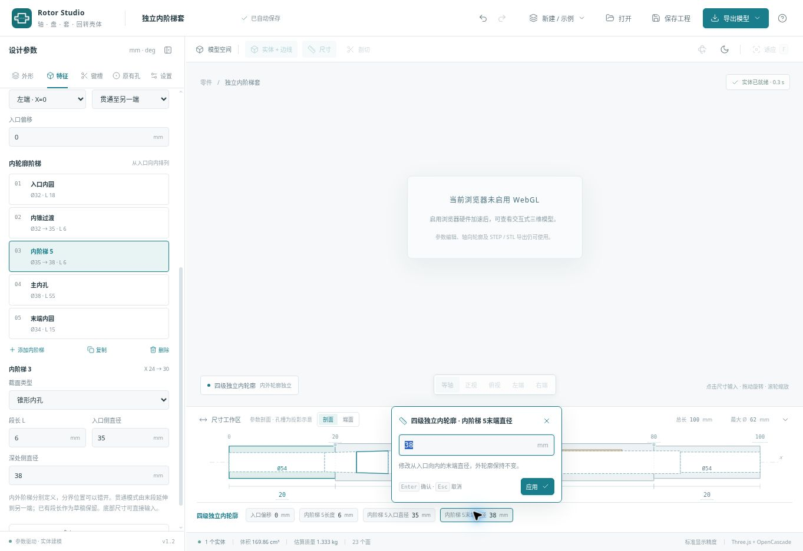
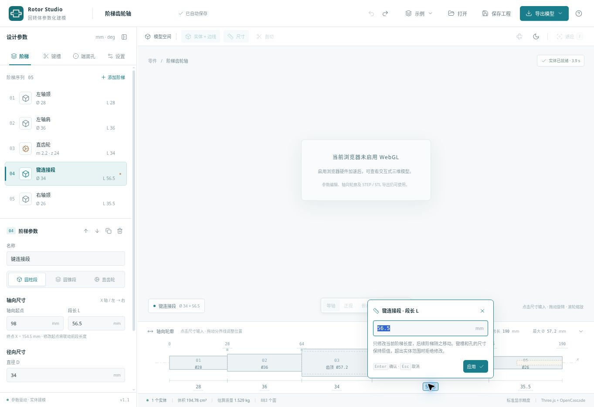

# 验证记录

验证日期：2026-10-30。当前功能版本：v1.2。

## v1.2 最终自动检查

九个测试文件直接运行，共 **100 项通过、0 失败、0 跳过**。生产构建通过。测试命令及软件预览复现方式见根目录 README。

| 测试文件 | 通过数 | 主要内容 |
| --- | ---: | --- |
| schema.test.mjs | 25 | 原轴、齿轮、键槽、端面孔的结构与范围约束 |
| features.test.mjs | 11 | v1/v2兼容、独立内腔、引用顺序、连续材料、最终螺纹包络、环槽交叉余量 |
| dimensions.test.mjs | 19 | 原尺寸及新特征联动、派生值、非法输入不污染工程 |
| feature-ui.test.mjs | 4 | 七个模板的特征初值、删除依赖、完整尺寸身份、CSV逐孔坐标与文本安全 |
| cad.test.mjs | 14 | 原有真实几何、键槽、体积、拓扑与导出 |
| rotational-cad.test.mjs | 9 | 内腔、径向孔、槽、语义螺纹、模板及拆分回归 |
| viewport-dimensions.test.mjs | 10 | 按钮事件、共享输入焦点、网格替换后的选中状态 |
| viewport-features.test.mjs | 6 | 三维特征尺寸锚点、左右入口、径向孔与穿壁厚度 |
| viewport-export.test.mjs | 2 | OBJ毫米与GLB米单位、原点、辅助物排除 |
| **总计** | **100** | |

实体检查使用实际 OpenCascade 运算，并非只检查界面字段。新增验证包含圆柱/圆锥内腔解析去料体积、近侧穿壁与全直径贯穿的截面取样、径向沉孔深度、内外环槽及内键槽体积、旧齿轮轴升级后的几何一致性。螺纹语义开关不生成牙形，也不额外改变底孔实体。

浏览器验收发现连续内锥拆分时，逐段刀具融合会触发内核异常。已改为完整内轮廓一次旋转生成刀具，在构造时移除共线中间点，保留全部参数段和引用。针对性回归覆盖左/右入口 × 连续锥段/同径圆柱四种情形，分别验证拆分前后体积、表面积、单实体和 STEP 回读。

## v1.2 示例实体与 STEP 回读

以下文件均由最终源码重新生成；原始数值保存在 [validation-summary.json](../examples/v1.2/validation-summary.json)。

| 示例 | 原实体体积 mm³ | STEP相对体积差 | 回读结果 |
| --- | ---: | ---: | --- |
| 六孔法兰盘 | 144763.84387276124 | 9.85 × 10⁻¹⁵ | 有效单实体 |
| 独立内阶梯套 | 169857.60762594792 | 2.04 × 10⁻¹⁴ | 有效单实体 |
| 杯形安装壳 | 242837.85438161768 | 3.72 × 10⁻¹⁵ | 有效单实体 |

[三联预览](screenshots/rotational-parts-v1.2.png)直接使用这些实体网格进行软件光栅化。它不是浏览器截图，不替代 WebGL 的视觉验收。

## v1.2 浏览器交互检查

已在实际开发页面执行：

| 检查 | 实际结果 |
| --- | --- |
| 三个模板 | 法兰盘、内阶梯套、杯壳均生成单实体并开放导出 |
| 内径输入 | 杯壳内径60 → 64 mm，外形保持原值，壁厚同步变化 |
| 底厚输入 | 对侧底厚18 → 20 mm，内腔长度62 → 60 mm，总长保持80 mm |
| 壁厚驱动 | 最小壁厚设为12 mm，按端部倒角处最小外半径39.2 mm反算内径54.4 mm |
| 非法输入 | 内径100 mm被拒绝；浮层显示原因，有效模型及尺寸保留，Esc可取消 |
| 连续操作 | 通知移至尺寸工作区上方并不拦截点击；连续提交壁厚、再打开内径输入成功 |
| 撤销/重做 | 修改后的有效参数可撤销并重做，实体重新构建 |
| 螺纹规格与终止方式 | M6×1切到M8×1.25，底孔5 → 6.8 mm；数量改1后，穿当前壁与贯穿全部均可切换并重建 |
| 引用保护 | 将穿壁孔移到内腔之前被拒绝；删除被引用内腔时提示先改绑/删除关联特征 |
| 新增内键槽 | 杯壳中默认使用90°，避开0°径向螺纹孔，重建成功 |
| 内阶梯选择与拆分 | 从轮廓选择内锥；Ø32→38、L12拆成Ø32→35、L6和Ø35→38、L6，实体就绪且体积仍为169.86 cm³ |
| 端面孔位 | 从端面示意点击孔选中阵列；PCD76 → 74 mm、数量6 → 8，视图显示8孔，实体成功重建 |
| 孔表入口 | 点击CSV后显示“孔位与螺纹参数表已生成”及文件下载链接 |

下图为最终代码在开发页面的内阶梯尺寸输入截图，包含实际的 WebGL 不可用提示、有效实体状态和共享输入浮层。

## v1.0 / v1.1 自动检查（保留历史记录）

共60项：参数模型25项、实体内核14项、尺寸编辑13项、三维尺寸按钮行为6项、GLB/OBJ文件2项。全部通过，生产构建成功。运行入口见根目录 README。

- 圆柱、圆锥及45°倒角的体积、表面积与解析计算一致。
- 多段回转体和多齿轮段融合为1个连续实体，使用 BRepCheck_Analyzer 检查有效性。
- 圆头/方头键槽、左右端盲孔、通孔、六孔阵列与沉孔确实减少实体体积。
- 四个示例均可构建有效实体；标准/精细网格设置不改变 B-Rep 体积。
- STEP 导出后重新导入，实体体积保持一致。
- 二进制 STL 长度与三角形数量一致。
- OBJ 保留毫米尺寸和 X=0 原点；GLB 将毫米转换为米，均不包含辅助线、地面、尺寸标注或显示剖切。
- 参数校验覆盖非法数字、版本、结构、重复标识、规模上限、齿顶变尖/齿根相交、键槽越界、孔间重叠及孔沿途穿出侧壁等情况。
- 隐藏的旧类型参数保留为草稿；切回对应类型重新执行物理范围检查。

## v1.0 默认实体导出实测（保留原始记录）

`examples/rotor-default.stats.json` 保存原始数值。

| 项目 | 结果 |
| --- | --- |
| 总长 | 180 mm |
| 最大齿顶直径 | 52 mm |
| 实体数量 | 1 |
| 原始实体体积 | 172613.66897178683 mm³ |
| STEP 回导体积 | 172613.6689717858 mm³ |
| 相对体积差 | 约 5.90×10⁻¹⁵ |
| STEP 回导拓扑 | 有效单实体 |
| B-Rep 面数 | 885 |
| STL 三角形 | 6020 |

## v1.0 浏览器交互检查

已在实际页面中执行：

1. 修改齿数，确认节圆、齿顶、齿根直径和实体统计更新。
2. 将键槽改为方头并复制至180°位置，确认特征列表和实体重建成功。
3. 新增左端孔组，将孔数改为2而保持PCD=0，确认报错并暂停导出。
4. 将PCD改为16 mm，确认恢复有效单实体，重新开放导出。
5. 执行STEP导出，确认生成对应文件的显式下载链接。

## 尚未完成的环境相关验收

v1.2验证浏览器同样报告 WebGL GPU 被禁用，无法创建 WebGL 上下文。因此没有完成 Three.js 金属材质、阴影、拾取、尺寸标签遮挡和相机交互的GPU画面验收。应用保留明确兼容性提示，并继续允许参数编辑、轮廓查看及STEP/STL/JSON输出。

自动浏览器的下载文件事件与文件传回接口超时，未取得该浏览器生成文件的落盘副本。STEP/STL字节生成及STEP回导已在独立内核测试中验证；网页已确认显示生成后的下载入口。实际桌面浏览器点击下载的落盘过程仍需本机检查。

`examples/rotor-default-preview.png` 根据实际导出的 STL 三角形做静态软件光栅化，是几何预览，不是Three.js界面截图或GPU验收证据。

## v1.1 新增自动检查

- 五种键槽及旧 JSON 导入兼容，单圆头最短槽长、半圆键槽刀径/深度/派生长度和所属阶梯边界。
- 左圆右方、左方右圆的真实圆端朝向及镜像体积；半圆键槽的圆弧槽底、独立圆弓积分去料体积、周向旋转和邻肩保护。
- 包含新增槽型的混合零件导出 STEP 后回读，保持有效单实体及体积一致。
- 六类直接输入尺寸的实际联动、非法输入、倒角/键槽/孔越界拒绝、原工程不被失败输入修改、十进制边界及输入精度。
- 尺寸标签的参数目标映射、按钮事件隔离、相机暂停恢复、标签重建后的键盘焦点保持；输入框持焦点时不会被抢焦点。
- 体积统计改用 OCCT 自适应积分，消除原非自适应积分对左右镜像槽产生的约 0.329 mm³ 统计偏差。实体几何不因积分方式改变。

## v1.1 浏览器交互检查

在实际开发页面中完成：

| 检查 | 结果 |
| --- | --- |
| 底部段长直接输入 | 键连接段 52 → 56.5 mm，总长 180 → 184.5 mm，左栏和轮廓同步 |
| 越界保护 | 输入 20 mm 导致键槽越界，输入框显示错误，56.5 mm 原尺寸保留 |
| 齿顶直径联动 | 52 → 57.2 mm，模数 2 → 2.2，齿数保持24 |
| 起点编辑 | 直齿轮起点 60 → 64 mm，前段长度 32 → 36 mm，齿宽保持34 mm |
| 总长编辑 | 188.5 → 190 mm，仅末段 34 → 35.5 mm |
| 撤销与重做 | Ctrl+Z 恢复188.5 mm，Ctrl+Shift+Z恢复190 mm |
| 取消输入 | 输入195 mm后Esc取消，总长保持190 mm，焦点返回尺寸按钮 |
| 横向滚动 | 14段轮廓产生水平滚动后，点击末段尺寸仍能保持输入框打开 |
| 半圆键槽 | 切换Woodruff后出现24 mm刀径，槽深3 mm派生槽口长约15.8745 mm；派生长度只读，实体重建成功 |
| 三维按钮原生事件 | 独立回归页复用产品按钮：click、Enter、Space各触发一次；目标及锚点正确，尺寸事件向父层冒泡计数为0 |

原生按钮回归入口：启动开发服务器后访问 `/tests/viewport-dimensions.browser.html`。该页面不创建WebGL上下文，不替代完整三维场景的GPU验收。

下图为实际开发页面的尺寸编辑交互截图。当前验证浏览器禁用WebGL，因此中间视口显示环境提示；底部轮廓、输入浮层与实体内核正常工作。

